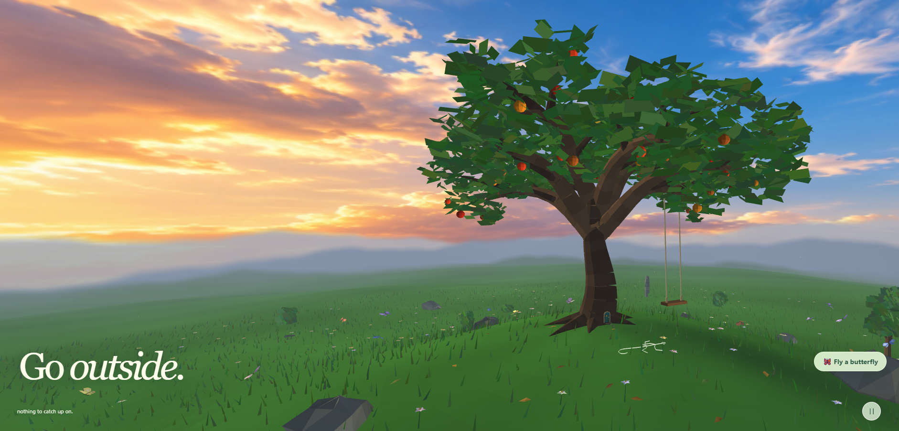

# Meadow 🌿

A small, living WebGL landscape: rolling grassland, a procedural apple tree and rope swing, butterflies, a wandering lizard, and a hidden aerial racing game. Built with plain HTML, JavaScript and WebGL. The ordinary meadow needs no accounts or backend; optional robot riding loads a real trained neural policy and MuJoCo WebAssembly physics **only after the visitor chooses it**.



## What it does

- Procedural hillside, flowers, shrubs, rocks, moss, pollen and falling leaves.
- Apple tree with fruit, fairy door, swing and butterfly perches.
- Background butterflies exploring flowers and canopy perches.
- Ground lizard with articulated movement and hunting behaviour.
- Playable butterfly flight with flapping, gliding, nectar, landing and perching.
- Hidden stone arch leading to three aerial race circuits with boosts, time penalties and local best-times.
- Mobile controls including a thumbstick, optional phone tilt steering and fullscreen support where the browser allows it.
- **Optional EMU robot ride:** the pinned 260M-step trained neural actor runs six physical actuators through real MuJoCo WASM, on a Meadow-derived collision heightfield. The **Walk the robot (12.5 MB download)** button shows byte-accurate progress; butterfly-only visitors download none of these robot extras.
- Third-person **mouse/touch drag orbit** and **wheel/pinch zoom** for both flying butterfly and walking EMU. Release eases back into follow mode; the chosen zoom persists.

## Files

| File | Purpose |
| --- | --- |
| `index.html` | Simple entry point for GitHub Pages and static hosting. |
| `meadow.html` | Main WebGL scene, procedural world, flight, racing and HUD. |
| `ground-lizard.js` | Standalone lizard simulation, loaded by relative path. |
| `skybox.png` | Local sky panorama, loaded by relative path. |
| `emu/champion.emupolicy` | Public trained neural policy (~0.89 MB); loaded only on request. |
| `emu/emu.js`, `emu/policy.js` | Byte-progress loader and browser inference. |
| `emu/physics/dist/` | Prebuilt MuJoCo JavaScript runtime and ~10.93 MB WASM; no server build needed. |
| `DEPLOY_WINDOWS_NGINX.md` | Production deployment for the existing Windows nginx + private PHP homepage. |

## Running it

### GitHub Pages

If this repository is published with GitHub Pages, just open the site URL.

### Local use

For best results, serve the folder through a small local web server instead of opening the HTML directly from a ZIP or `file://` URL.

```bash
python -m http.server 8000
```

Then visit `http://localhost:8000/`.

Opening `meadow.html` directly may still work, but some browsers restrict WebGL textures from local file URLs.

## Controls

| | Keyboard / mouse | Phone / tablet |
| --- | --- | --- |
| Explore | Drag to orbit, wheel to zoom | Drag to orbit |
| Start flying | **Fly a butterfly** or `F` | **Fly a butterfly** |
| Fly | `W/S` pitch, `A/D` bank, `Space` flap | Thumbstick + **Flap**, or optional tilt |
| Perch | Approach surfaces gently | Same |
| Look around while flying, perched or riding | Drag scene; release to resume follow camera | Drag scene; release to resume follow camera |
| Zoom while piloting | Mouse wheel / trackpad | Two-finger pinch on scene |
| Walk EMU (optional 12.5 MB) | Click **Walk the robot**, W/S speed, A/D steering, Space dismount | Walk button, joystick, **Fly away** |
| Leave flight | `Esc` or **Exit** | **Exit** |

On mobile, **Recenter** makes the current phone angle neutral. Motion sensing requires HTTPS or localhost and may require permission.

## Hidden race

Find the small stone arch beyond the tree. Passing through it reveals green, orange and red course choices ahead of you. Each course follows a looping 3D route over the meadow and returns to the arch. Skipping one checkpoint costs five seconds, while a 30-second gap without progress ends the attempt. Personal bests are stored only in the browser with `localStorage`.

## Notes

This public repository includes the optional **robot inference weights and compiled physics assets**, but **never** includes the private homepage system, PHP link manager, server monitors, passwords or private configuration.

For the production Windows nginx server, deploy only the static Meadow files described in [DEPLOY_WINDOWS_NGINX.md](DEPLOY_WINDOWS_NGINX.md), **not** this repository's `index.html` over the existing `C:\\nginx\\html\\index.php`. The site's existing PHP homepage and `hangar/` applications stay intact. The robot requires no Python, JAX, GPU, or long-running server process.
